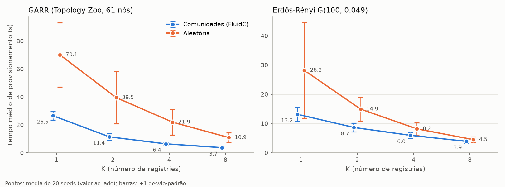
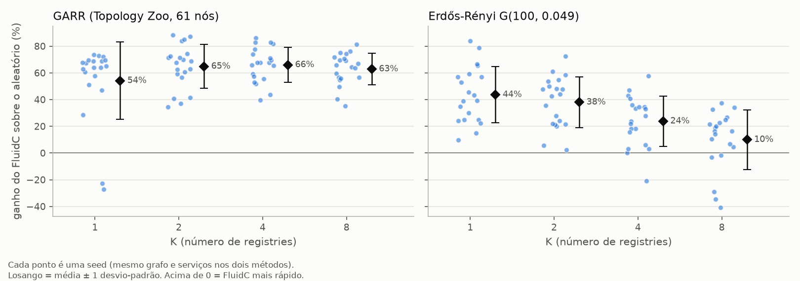

# PraticaPesquisaEdge
Repositório dedicado à pesquisa em Edge Computing utilizando o simulador EdgeSimPy. O projeto foca na modelagem de cenários de redes celulares e na simulação do posicionamento estratégico de Container Registries na borda para otimizar o tempo de provisionamento de aplicações.

Reprodução e extensão de Knob et al. (2021), *Community-based Placement of Registries to Speed up
Application Deployment on Edge Computing* (IEEE IC2E, DOI 10.1109/IC2E52221.2021.00029).

## Ambiente

```bash
git clone https://github.com/EdgeSimPy/EdgeSimPy.git
cd EdgeSimPy && pip install -e . && cd ..
pip install matplotlib networkx
```

Todos os comandos abaixo rodam a partir da raiz do repositório.

## Scripts

| Script | O que faz |
|---|---|
| `scripts/topologia.py` | Carrega/gera grafos: GARR (arquivo), aleatória G(n, m), Erdős-Rényi G(n, p), leitor do GML do Topology Zoo e aproximação sintética da GARR |
| `scripts/fluidc_placement.py` | Algoritmo do artigo: FluidC (comunidades balanceadas) + nó de maior centralidade de autovetor por comunidade; baseline aleatório |
| `scripts/gerar_topologias.py` | Baixa a GARR real do Topology Zoo e gera Erdős-Rényi G(n, p); opcionalmente gera os datasets EdgeSimPy |
| `scripts/gerar_cenario.py` | Gera um dataset EdgeSimPy (topologia + K registries + serviços) |
| `scripts/run_cenario.py` | Simula um dataset e mede o tempo de provisionamento e a saturação dos links |
| `scripts/experimento.py` | Varredura K × método × seeds (chama os dois scripts acima) |
| `scripts/analise_estrategias.py` | Consolida as varreduras: média, desvio-padrão, IC95%, ganho pareado por seed e gráficos |

## Topologias

**GARR (rede acadêmica italiana).** `python scripts/gerar_topologias.py --garr` baixa `Garr201201.gml`
do [Internet Topology Zoo](http://www.topology-zoo.org/), a última versão da GARR publicada lá (mapa de
nov/2011). Se o site estiver fora do ar, o script usa o Wayback Machine. O arquivo bruto fica em
`cenarios/garr/Garr201201_zoo.gml` e a versão limpa em `cenarios/garr/garr.gml`.

- Grafo real: 61 nós (48 PoPs + 13 pontos de peering externos, como GEANT, MIX e NAMEX) e 89 arestas,
  que viram 75 links ao colapsar as paralelas. O grau médio é 2,46 e o diâmetro, 8 saltos.
- **Diferença em relação ao artigo:** o artigo cita 70 nós / 112 links, e nenhuma versão pública do Zoo
  tem esse tamanho (a maior tem 61/75). Por isso o `garr.gml` exige `--ignorar-contagem`.
- `--so-internos` descarta os 13 nós externos. `--banda-real` usa a banda real de cada link (de 34 Mbps a
  ~21 Gbps, somando links paralelos); sem ela, todos os links recebem `--banda-link` (padrão 1 Gbps, como na Tabela II do artigo).
- Sem acesso à rede e sem o arquivo local, o script usa `topologia.aproximacao_garr`: uma árvore de
  anexação preferencial com atalhos, parametrizável por `--aprox-nos` e `--aprox-links`. O uso da
  aproximação fica registrado em `garr.info.json`.

**Erdős-Rényi G(n, p).** `--topologia erdos_renyi --nos 100 --prob 0.049`. Com 100 nós, p = 0,049 dá
em média 242 links, o mesmo tamanho da topologia aleatória do artigo. Se o grafo sorteado sair
desconexo, o gerador sorteia de novo. Cada seed gera um grafo diferente; nas 20 seeds usadas, foram
de 207 a 272 links (média 244).

## Imagens, banda e resolução temporal

- Imagens: 13 imagens de 200 MB (Tabela II do artigo), configuráveis com `--tamanho-imagem MB` ou com
  `--tamanho-faixa MIN,MAX`, que sorteia o tamanho de cada imagem. O sorteio usa um gerador próprio da
  seed, então FluidC e aleatório recebem as mesmas imagens.
- Banda: links de 1 Gbps (125 MB/s) e acesso ao registry de 10 Gbps, ambos configuráveis
  (`--banda-link`, `--banda-registry`).
- `--segundos-por-tick`: a cada tick, o EdgeSimPy desconta `bandwidth` MB de cada fluxo, sem considerar
  o `tick_duration`. Por isso a banda vai para o dataset em MB/tick (banda × s/tick) e o tempo em
  segundos é ticks × s/tick. Os experimentos usam 0,1 s/tick. Na GARR com K=2, o tempo médio difere
  ~2% entre 1 s e 0,02 s por tick, e 0,1 s já coincide com 0,02 s. O `run_cenario.py` grava o tempo em
  segundos em `tempo_provisionamento_s`.

## Como reproduzir os resultados

```bash
python scripts/gerar_topologias.py --garr --er

python scripts/experimento.py --topologia garr --garr-arquivo cenarios/garr/garr.gml --ignorar-contagem \
    --ks 1,2,4,8 --seeds 1,2,3,4,5,6,7,8,9,10,11,12,13,14,15,16,17,18,19,20 \
    --segundos-por-tick 0.1 --max-ticks 36000 --jobs 6 --nome garr

python scripts/experimento.py --topologia erdos_renyi --nos 100 --prob 0.049 \
    --ks 1,2,4,8 --seeds 1,2,3,4,5,6,7,8,9,10,11,12,13,14,15,16,17,18,19,20 \
    --segundos-por-tick 0.1 --max-ticks 36000 --jobs 6 --nome erdos_renyi

python scripts/analise_estrategias.py resultados/garr resultados/erdos_renyi --saida resultados/estrategias
```

Leva ~15 minutos em 12 núcleos. A comparação é pareada: na mesma seed, os dois métodos usam o mesmo
grafo, os mesmos 60 serviços e as mesmas imagens, e só muda a posição dos registries. Os diretórios de
detalhe por execução (`resultados/<topologia>/<topologia>_<metodo>_k<K>_s<seed>/`) ficam fora do git.

## Resultados: comunidades (FluidC) × aleatória

Tempo médio de provisionamento dos 60 serviços, com média ± desvio-padrão de 20 seeds. O ganho é
1 − t_FluidC / t_aleatório, calculado seed a seed. O p-valor vem do teste de permutação pareado exato
(troca de sinais).

| Topologia | K | FluidC (s) | Aleatória (s) | Ganho do FluidC | FluidC venceu | p |
|---|---|---|---|---|---|---|
| GARR | 1 | 26,5 ± 3,1 | 70,1 ± 22,9 | 54% ± 29 | 18/20 | < 0,001 |
| GARR | 2 | 11,4 ± 2,3 | 39,5 ± 18,8 | 65% ± 16 | 20/20 | < 0,001 |
| GARR | 4 | 6,4 ± 1,0 | 21,9 ± 9,1 | 66% ± 13 | 20/20 | < 0,001 |
| GARR | 8 | 3,7 ± 0,4 | 10,9 ± 3,6 | 63% ± 12 | 20/20 | < 0,001 |
| Erdős-Rényi | 1 | 13,2 ± 2,4 | 28,2 ± 16,3 | 44% ± 21 | 20/20 | < 0,001 |
| Erdős-Rényi | 2 | 8,7 ± 1,5 | 14,9 ± 4,1 | 38% ± 19 | 20/20 | < 0,001 |
| Erdős-Rényi | 4 | 6,0 ± 1,0 | 8,2 ± 2,1 | 24% ± 19 | 19/20 | < 0,001 |
| Erdős-Rényi | 8 | 3,9 ± 0,6 | 4,5 ± 1,0 | 10% ± 22 | 15/20 | 0,017 |




Leitura:
- O FluidC é mais rápido em todas as combinações de topologia e K, com diferença significativa em todas.
  Ele também é mais estável: o desvio-padrão entre seeds é menor em todos os casos, de 1,8x (Erdős-Rényi,
  K=8) a 9x (GARR, K=8) menor que o da aleatória.
- Na GARR, uma rede quase em árvore e com hubs, o ganho fica em ~55–66% para todo K. Um registry mal
  posicionado numa folha da árvore congestiona os poucos caminhos disponíveis.
- No Erdős-Rényi, uma rede mais densa e homogênea, o ganho cai à medida que K cresce (44% → 10%). Com
  8 registries, até um posicionamento aleatório já deixa quase todo nó perto de um registry.
- K=1 só mede a escolha do nó central: com uma comunidade só, o FluidC se reduz à centralidade de
  autovetor. Nas 2 seeds da GARR em que perdeu (por 23% e 27%), o sorteio aleatório caiu num nó melhor que o
  central para aquela distribuição de serviços.

Arquivos: `resultados/estrategias/` (estatísticas e gráficos consolidados) e `resultados/garr/` e
`resultados/erdos_renyi/` (saída do `experimento.py`: resumo por execução, médias por K, CDF e saturação
de links intra/inter-comunidade).

## Resultados anteriores

`resultados/resultados.csv` e `resultados/grafico_provisionamento.png` vêm da primeira rodada
(dataset do Thea, 1 registry, varrendo os 18 servidores): a posição do registry importa, e a melhor
posição é 2x mais rápida que a pior.
