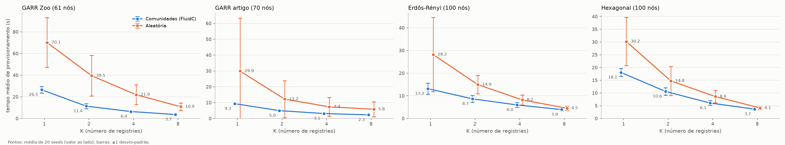
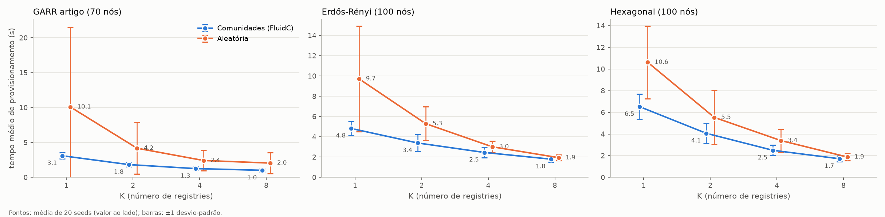
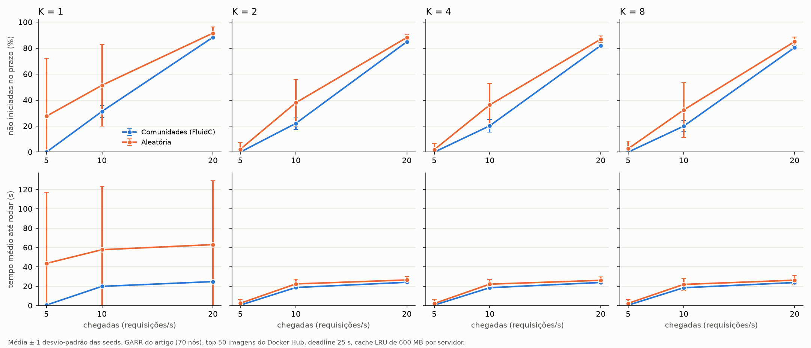

# PraticaPesquisaEdge
Repositório dedicado à pesquisa em Edge Computing utilizando o simulador EdgeSimPy. O projeto foca na modelagem de cenários de redes celulares e na simulação do posicionamento estratégico de Container Registries na borda para otimizar o tempo de provisionamento de aplicações.

Reprodução e extensão de Knob et al. (2021), *Community-based Placement of Registries to Speed up
Application Deployment on Edge Computing* (IEEE IC2E, DOI 10.1109/IC2E52221.2021.00029).

## Ambiente

```bash
git clone https://github.com/EdgeSimPy/EdgeSimPy.git
cd EdgeSimPy && pip install -e . && cd ..
pip install matplotlib networkx
```

Todos os comandos abaixo rodam a partir da raiz do repositório.

## Scripts

| Script | O que faz |
|---|---|
| `scripts/topologia.py` | Carrega/gera grafos: GARR (GML do Topology Zoo ou JSON do artigo), aleatória G(n, m), Erdős-Rényi G(n, p), malha hexagonal e aproximação sintética da GARR |
| `scripts/fluidc_placement.py` | Algoritmo do artigo: FluidC (comunidades balanceadas) + nó de maior centralidade de autovetor por comunidade; baseline aleatório |
| `scripts/gerar_topologias.py` | Baixa a GARR do Topology Zoo e gera Erdős-Rényi e hexagonal; opcionalmente gera os datasets EdgeSimPy |
| `scripts/coletar_dockerhub.py` | Coleta as imagens mais baixadas do Docker Hub, com tamanho e camadas (`cenarios/dockerhub_top50.json`) |
| `scripts/gerar_cenario.py` | Gera um dataset EdgeSimPy (topologia + K registries + imagens + serviços) |
| `scripts/run_cenario.py` | Simula um dataset e mede o tempo de provisionamento e a saturação dos links |
| `scripts/carga_trabalho.py` | Carga de trabalho do artigo (chegadas de Poisson, deadline, tempo de vida, cache LRU), usada pelo `run_cenario.py` |
| `scripts/experimento.py` | Varredura K × método × seeds (chama `gerar_cenario.py` e `run_cenario.py`) |
| `scripts/analise_estrategias.py` | Consolida as varreduras: média, desvio-padrão, IC95%, ganho pareado por seed, vitórias/empates/derrotas e gráficos |
| `scripts/analise_carga.py` | Consolida a varredura de taxa de chegada (modo carga de trabalho) |

## Topologias

| Topologia | Nós | Links | Grau médio | Diâmetro | Arquivo / parâmetros |
|---|---|---|---|---|---|
| GARR do artigo | 70 | 111 | 3,17 | 9 | `cenarios/garr/garr-topology.json` (enviado pelo professor) |
| GARR do Topology Zoo | 61 | 75 | 2,46 | 8 | `cenarios/garr/garr.gml` |
| Erdős-Rényi G(n, p) | 100 | ~244 | ~4,9 | ~5 | `--topologia erdos_renyi --nos 100 --prob 0.049` |
| Hexagonal (celular) | 100 | 261 | 5,22 | 14 | `--topologia hexagonal --hex-x 10 --hex-y 10` |

**GARR do artigo (principal).** É a versão usada pelo Knob, com nome e posição de cada nó e banda por
link escrita como "1.0Gb", "10.0Gb" etc. O `topologia.py` lê esse formato. O artigo cita 112 links; o
arquivo tem um link duplicado, que é descartado, e por isso ficam 111. Use `--ignorar-contagem`. As
bandas vêm do próprio arquivo: 50 links de 10 Gbps, 23 de 1 Gbps, 12 de 2 Gbps e 26 entre 3 e 100 Gbps.

**GARR do Topology Zoo.** `python scripts/gerar_topologias.py --garr` baixa `Garr201201.gml` do
[Internet Topology Zoo](http://www.topology-zoo.org/) (pelo Wayback Machine se o site estiver fora do ar).
São 48 PoPs + 13 peerings externos. Foi a versão usada antes de recebermos o arquivo do artigo e fica
como comparação. Opções: `--so-internos`, `--banda-real`; sem rede, usa a aproximação
`topologia.aproximacao_garr`.

**Erdős-Rényi G(n, p).** Com 100 nós, p = 0,049 dá em média 242 links, o tamanho da topologia aleatória
do artigo. Se o grafo sair desconexo, o gerador sorteia de novo; cada seed gera um grafo diferente.

**Hexagonal (novidade, sugestão do professor).** Malha de células hexagonais no estilo de rede celular:
cada nó (estação-base + servidor) se liga às até 6 células vizinhas. Segue a mesma convenção do gerador
do EdgeSimPy (`dataset_generator.map.hexagonal_grid` + `partially_connected_hexagonal_mesh`); conferimos
que os links são idênticos. Tem o mesmo número de nós da Erdős-Rényi, mas é uma rede "longa": o diâmetro
é 14 saltos, contra ~5 da Erdős-Rényi.

## Imagens

- **Fictícias (artigo):** 13 imagens de 200 MB, cada uma com uma camada (Tabela II do artigo).
  Configuráveis com `--tamanho-imagem` ou `--tamanho-faixa MIN,MAX`.
- **Top 50 do Docker Hub (novidade, sugestão do professor):** `--imagens-dockerhub cenarios/dockerhub_top50.json`.
  São imagens reais (nginx, postgres, redis, python, node, mysql, grafana...) com as camadas reais, de
  0,002 MB a 503 MB. As camadas com o mesmo digest são a mesma camada: o registry guarda uma cópia, e o
  EdgeSimPy não baixa de novo uma camada que o servidor já tem. São 290 camadas distintas; o catálogo
  ocupa 5,0 GB sem repetir camadas (6,0 GB somando as imagens inteiras). Os tamanhos são os comprimidos,
  que é o que trafega num `docker pull`.
  - Escolha da imagem de cada serviço: `--popularidade uniforme` (padrão, como no artigo) ou `zipf`
    (peso 1/posição no ranking de downloads).
  - Correções feitas na leitura: camadas de 0 MB viram 1 KB; a imagem sem lista de camadas
    (`v2tec/watchtower`) vira uma camada única com o tamanho total; e digests repetidos dentro da mesma
    imagem entram uma vez só (ver "Armadilhas do EdgeSimPy").

## Banda e resolução temporal

- Links com a banda do arquivo (GARR do artigo) ou 1 Gbps (demais); acesso ao registry de 10 Gbps.
- `--segundos-por-tick`: a cada tick, o EdgeSimPy desconta `bandwidth` MB de cada fluxo, sem considerar
  o `tick_duration`. A banda vai para o dataset em MB/tick (banda × s/tick) e o tempo em segundos é
  ticks × s/tick. Todos os experimentos usam **0,1 s/tick**.
  - Com as imagens fictícias (200 MB numa camada), 1 s/tick já mede bem (erro de ~2%).
  - Com as imagens do Docker Hub (muitas camadas pequenas), **1 s/tick não serve**: quase toda camada
    termina dentro do primeiro tick, e o tempo medido vira só o overhead fixo de ~2 ticks por
    provisionamento. Nesse caso os dois métodos dão resultados idênticos e a rede "some".

## Modo carga de trabalho (artigo)

`run_cenario.py --chegadas TAXA` troca o "60 serviços de uma vez" pela carga descrita no artigo
(detalhes e suposições em `scripts/carga_trabalho.py`):

| Parâmetro | Valor | Origem |
|---|---|---|
| Chegadas | Poisson, `--chegadas` req/s (artigo: ~5) durante `--duracao` s (artigo: 3600) | artigo |
| Deadline | `--deadline-min`/`--deadline-max` (artigo: mínimo de 25 s) | artigo |
| Métrica | % de requisições cujo container não estava rodando até o deadline | artigo |
| Cache | `--cache-mb` por servidor, LRU (artigo: 600 MB) | artigo |
| Tempo de vida do container | `--tempo-vida` (usamos 30 s) | **suposição** |
| Escalonador | aleatório entre servidores com capacidade | igual ao modo rajada |

O tempo de vida é necessário: cada servidor do template aceita 4 containers, e sem liberar espaço os
servidores lotam em poucos minutos. Com 30 s, a GARR do artigo sustenta ~9 req/s.

## Armadilhas do EdgeSimPy (encontradas e contornadas)

1. **Banda é MB por tick**, não MB/s (ver `--segundos-por-tick`).
2. **Digest repetido numa imagem trava outra imagem.** Se uma imagem lista a mesma camada duas vezes (a
   "empty layer" `4f4fb700ef54`, por exemplo), o EdgeSimPy coloca duas cópias dela na fila do servidor.
   Qualquer outra imagem que use a mesma camada nesse servidor nunca termina de provisionar, porque o
   `Service.step` compara a contagem de camadas baixadas com `len(layers_digests)`. O `gerar_cenario.py`
   remove os digests repetidos.
3. **Memória cresce com os ticks** por causa da coleta interna de métricas: `sim.monitor` é desligado
   no `run_cenario.py`.
4. **Listas de agentes só crescem** (fluxos concluídos, cópias de camadas). Em simulações longas (modo
   carga), os fluxos concluídos e as camadas despejadas do cache são retirados dessas listas.

## Como reproduzir

```bash
SEEDS=1,2,3,4,5,6,7,8,9,10,11,12,13,14,15,16,17,18,19,20
COM="--ks 1,2,4,8 --seeds $SEEDS --segundos-por-tick 0.1 --max-ticks 36000 --jobs 6"
DH="--imagens-dockerhub cenarios/dockerhub_top50.json"
GARR70="--topologia garr --garr-arquivo cenarios/garr/garr-topology.json --ignorar-contagem"

# rajada, imagens fictícias
python scripts/experimento.py $GARR70 $COM --nome garr70
python scripts/experimento.py --topologia garr --garr-arquivo cenarios/garr/garr.gml --ignorar-contagem $COM --nome garr
python scripts/experimento.py --topologia erdos_renyi --nos 100 --prob 0.049 $COM --nome erdos_renyi
python scripts/experimento.py --topologia hexagonal $COM --nome hexagonal

# rajada, top 50 do Docker Hub
python scripts/experimento.py $GARR70 $COM $DH --nome dh_garr70
python scripts/experimento.py --topologia erdos_renyi --nos 100 --prob 0.049 $COM $DH --nome dh_erdos_renyi
python scripts/experimento.py --topologia hexagonal $COM $DH --nome dh_hexagonal

# carga de trabalho do artigo (uma pasta por taxa de chegada)
for L in 5 10 20; do
  python scripts/experimento.py $GARR70 $DH --ks 1,2,4,8 --seeds 1,2,3,4,5,6,7,8,9,10 \
      --segundos-por-tick 0.1 --max-ticks 30000 --timeout 3600 --jobs 6 \
      --chegadas $L --duracao 600 --deadline-min 25 --deadline-max 25 --tempo-vida 30 --cache-mb 600 \
      --sem-detalhe-links --nome carga_garr70_l$L
done

# análises
python scripts/analise_estrategias.py resultados/garr resultados/garr70 resultados/erdos_renyi resultados/hexagonal \
    --rotulos "GARR Zoo (61 nós),GARR artigo (70 nós),Erdős-Rényi (100 nós),Hexagonal (100 nós)" \
    --saida resultados/estrategias_ficticias
python scripts/analise_estrategias.py resultados/dh_garr70 resultados/dh_erdos_renyi resultados/dh_hexagonal \
    --rotulos "GARR artigo (70 nós),Erdős-Rényi (100 nós),Hexagonal (100 nós)" --saida resultados/estrategias_dockerhub
python scripts/analise_carga.py resultados/carga_garr70_l5 resultados/carga_garr70_l10 resultados/carga_garr70_l20 \
    --saida resultados/carga_garr70
```

A comparação é pareada: na mesma seed, os dois métodos usam o mesmo grafo, os mesmos serviços e as
mesmas imagens, e só muda a posição dos registries. Os diretórios de detalhe por execução ficam fora do git.

## Resultados (modo rajada: 60 serviços de uma vez)

Tempo médio de provisionamento, média ± desvio-padrão de 20 seeds. Ganho = 1 − t_FluidC / t_aleatório,
seed a seed. V/E/D = seeds em que o FluidC venceu / empatou / perdeu. p = teste de permutação pareado
exato (todas as linhas com p < 0,05; a maioria com p < 0,001).

**Imagens fictícias do artigo** (`resultados/estrategias_ficticias/`)

| Topologia | K=1 | K=2 | K=4 | K=8 |
|---|---|---|---|---|
| GARR artigo (70) | 9,3 × 29,9 s (26%, 6/14/0) | 5,0 × 12,2 (39%, 18/0/2) | 3,1 × 7,4 (43%, 19/0/1) | 2,3 × 5,8 (43%, 20/0/0) |
| GARR Zoo (61) | 26,5 × 70,1 (54%, 18/0/2) | 11,4 × 39,5 (65%, 20/0/0) | 6,4 × 21,9 (66%, 20/0/0) | 3,7 × 10,9 (63%, 20/0/0) |
| Erdős-Rényi (100) | 13,2 × 28,2 (44%, 20/0/0) | 8,7 × 14,9 (38%, 20/0/0) | 6,0 × 8,2 (24%, 19/0/1) | 3,9 × 4,5 (10%, 15/0/5) |
| Hexagonal (100) | 18,1 × 30,2 (35%, 20/0/0) | 10,6 × 14,8 (22%, 16/0/4) | 6,1 × 8,6 (25%, 18/0/2) | 3,7 × 4,1 (9%, 13/0/7) |

**Top 50 do Docker Hub** (`resultados/estrategias_dockerhub/`)

| Topologia | K=1 | K=2 | K=4 | K=8 |
|---|---|---|---|---|
| GARR artigo (70) | 3,1 × 10,1 s (26%, 7/13/0) | 1,8 × 4,2 (36%, 18/0/2) | 1,3 × 2,4 (38%, 19/0/1) | 1,0 × 2,0 (35%, 19/0/1) |
| Erdős-Rényi (100) | 4,8 × 9,7 (40%, 20/0/0) | 3,4 × 5,3 (32%, 20/0/0) | 2,5 × 3,0 (17%, 17/0/3) | 1,8 × 1,9 (6%, 15/0/5) |
| Hexagonal (100) | 6,5 × 10,6 (34%, 20/0/0) | 4,1 × 5,5 (20%, 16/0/4) | 2,5 × 3,4 (22%, 17/0/3) | 1,7 × 1,9 (7%, 14/0/6) |

Formato: FluidC × aleatório (ganho médio, V/E/D).




Leitura:
- O FluidC é mais rápido, em média, em todas as 28 combinações, com diferença significativa em todas.
  Também é mais estável: em 22 dos 28 casos o desvio-padrão do aleatório entre seeds passa de 2× o do
  FluidC (só na Erdős-Rényi com Docker Hub e K=8 os dois são iguais).
- **GARR (as duas versões):** o ganho fica alto para qualquer K (35–66%). Uma rede acadêmica tem núcleo
  e periferia, e um registry sorteado na periferia congestiona os poucos caminhos.
- **GARR do artigo com K=1:** em 13–14 seeds o sorteio cai num nó do núcleo de 10 Gbps e empata
  exatamente com o FluidC; nas outras 6–7 cai num nó ruim e perde por ~85–90%. A média esconde essa
  distribuição bimodal, por isso reportamos V/E/D.
- **Erdős-Rényi e hexagonal:** o ganho cai conforme K cresce (de 34–44% em K=1 para 6–10% em K=8). Com
  8 registries em 100 nós, até o sorteio deixa quase todo nó perto de um registry.
- **Docker Hub × fictícias:** os tempos caem para 33–47% dos das fictícias (as imagens reais são menores
  na média e as camadas compartilhadas não são baixadas de novo), mas o ganho relativo do FluidC muda pouco.
  A conclusão do artigo resiste a imagens realistas.

## Resultados (carga de trabalho do artigo)

GARR do artigo (70 nós), top 50 do Docker Hub, deadline de 25 s, cache LRU de 600 MB por servidor,
tempo de vida de 30 s, 10 minutos de chegadas por simulação, 10 seeds (`resultados/carga_garr70/`).
Métrica: % de requisições cujo container não estava rodando até o deadline (média ± desvio-padrão).
Pareado: diferença aleatório − FluidC em pontos percentuais, seed a seed.

| Chegadas | K | FluidC | Aleatório | Diferença (V/E/D) | p |
|---|---|---|---|---|---|
| 5 req/s | 1 | 0,0 ± 0,0 % | 27,7 ± 44,6 % | 27,7 pp (3/7/0) | 0,25 |
| 5 req/s | 2 | 0,0 ± 0,0 % | 2,2 ± 5,1 % | 2,2 pp (3/7/0) | 0,25 |
| 5 req/s | 4 | 0,0 ± 0,0 % | 1,9 ± 5,0 % | 1,9 pp (3/7/0) | 0,25 |
| 5 req/s | 8 | 0,0 ± 0,0 % | 2,6 ± 5,9 % | 2,6 pp (2/8/0) | 0,50 |
| 10 req/s | 1 | 31,3 ± 4,6 % | 51,5 ± 31,5 % | 20,1 pp (7/0/3) | 0,08 |
| 10 req/s | 2 | 22,1 ± 4,7 % | 38,0 ± 18,0 % | 15,9 pp (9/0/1) | 0,006 |
| 10 req/s | 4 | 20,3 ± 4,8 % | 36,4 ± 16,5 % | 16,1 pp (10/0/0) | 0,002 |
| 10 req/s | 8 | 20,0 ± 4,2 % | 32,5 ± 21,0 % | 12,5 pp (8/0/2) | 0,018 |
| 20 req/s | 1 | 88,5 ± 0,7 % | 91,6 ± 4,9 % | 3,2 pp (8/0/2) | 0,018 |
| 20 req/s | 2 | 85,0 ± 0,4 % | 88,3 ± 2,1 % | 3,3 pp (10/0/0) | 0,002 |
| 20 req/s | 4 | 82,1 ± 1,1 % | 87,0 ± 2,4 % | 4,9 pp (9/0/1) | 0,004 |
| 20 req/s | 8 | 80,6 ± 1,5 % | 85,1 ± 3,5 % | 4,6 pp (9/0/1) | 0,004 |



Leitura:
- **5 req/s (a carga do artigo):** o FluidC não perdeu nenhuma requisição em nenhuma seed, com tempo até
  rodar estável (~0,5–0,6 s). O aleatório é bimodal: na maioria das seeds também zera, mas em 2–3 de cada
  10 o registry cai atrás de um link fraco e as perdas vão de 0,1% a 18% (K ≥ 2) ou de 87% a 95% (K = 1). Com 10
  seeds isso **ainda não é estatisticamente significativo** (p = 0,25: só 3 pares diferem de zero);
  precisa de mais seeds.
- **10 req/s:** logo acima da capacidade de computação (~9 req/s com tempo de vida de 30 s), parte das
  requisições se perde nos dois métodos, mas o FluidC perde 12–20 pontos a menos (significativo para
  K ≥ 2).
- **20 req/s:** a computação satura e os dois perdem mais de 80%; o FluidC ainda fica 3–5 pontos melhor.
- A taxa de acerto do cache de 600 MB fica em 11–15% nos dois métodos: com 50 imagens sorteadas de
  modo uniforme, o cache comporta poucas imagens por servidor.

## Resultados anteriores

- `resultados/garr`, `resultados/erdos_renyi`, `resultados/estrategias`: primeira rodada com a GARR do
  Topology Zoo e a Erdős-Rényi (imagens fictícias).
- `resultados/resultados.csv` e `resultados/grafico_provisionamento.png`: primeira rodada com o dataset
  do Thea (1 registry, varrendo os 18 servidores). A posição do registry importa, e a melhor posição é
  2x mais rápida que a pior.
